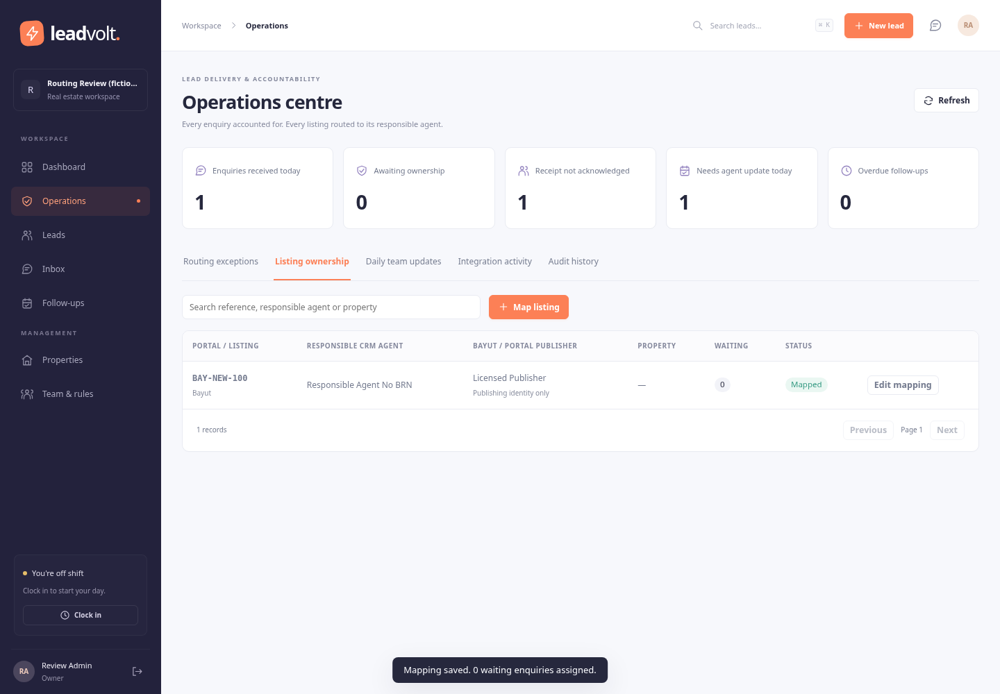
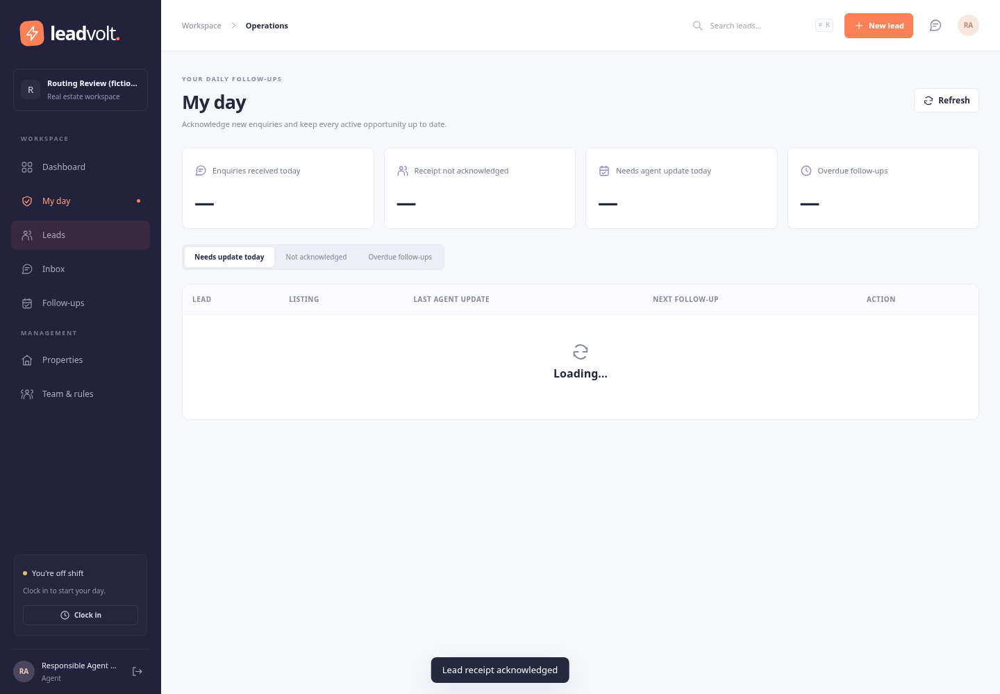

> Historical routing release. For the later company-controls upgrade and exact remaining work, read [NEXT_SESSION.md](../NEXT_SESSION.md). Its validation totals below describe that earlier release.

# Company workflow upgrade and validation

Review date: 20 October 2026 UTC. All validation data is fictional. This report supersedes the first interface-only review. Requirements here come from the company workflow stated in the conversation; claims in the supplied blueprint were treated as reference material, not instructions or proof of delivered functionality.

## Implemented behavior

| Company requirement | Result |
|---|---|
| Listings may be published under another agent's licensed Bayut account | A listing mapping stores the responsible CRM agent separately from the publishing agent/account. |
| Agents without a BRN must receive their own listing enquiries | BRN is optional metadata. An explicit listing mapping routes to its active responsible agent regardless of shift or rule capacity. |
| A first enquiry can introduce an unmapped listing reference | Intake creates the mapping record and saves an unassigned enquiry in Operations → Routing exceptions. |
| Admin must resolve assignment exceptions | Resolve once or remember the owner; saving a mapping assigns all waiting active enquiries and routes future customers. |
| Agents need to update leads every day | My day shows receipt acknowledgement, required daily updates and overdue follow-ups using the workspace business timezone. |
| Admin monitors delivery and follow-up | Operations provides exceptions, listing ownership, daily team updates, integration receipts and audit history. |

Unknown/missing references are held for review. Paused mappings and unavailable agents are also held. The agent cannot access or claim other agents' leads or the administrator's unassigned queue. Deactivation and non-receiving role changes revoke access and return open enquiries for review. Reassignment removes old-owner websocket access, transfers open tasks, and resets the new owner's receipt and daily-update requirements.

Enquiries are deduplicated by company, portal and stable provider event ID. Retries cannot increment re-enquiry totals or create another lead. A genuine new enquiry for the same contact and listing increments re-enquiry history. The same contact enquiring about another listing or portal retains a separate opportunity and owner. Missing-reference events stay separate until their property is identified. Existing assigned leads retain ownership when a mapping changes; administrators must reassign those explicitly.

Acknowledgement alone does not count as a daily update. Assigned-agent notes, calls, dispositions and completed tasks do; administrator touches do not credit the agent. Statuses validate required next steps and stale record versions. Active duplicate bookings are prevented and superseded bookings are retained as voided history.

## Reliability and security changes

- Replaced browser-stored bearer credentials with HttpOnly cookie sessions, Secure in production, CSRF headers and exact-origin checks. Login is rate limited. Disabled/changed accounts and logout invalidate existing sessions and websocket connections.
- Removed the caller-set database system-bypass flag. Request and cross-workspace worker pools now use distinct database principals. Production refuses privileged or worker-capable request connections. Composite tenant foreign keys prevent cross-company UUID references; audit rows cannot be updated/deleted by runtime roles.
- Added mandatory record versions for relevant edits. Concurrent competing lead updates result in one success and one stale-version rejection. Mapping changes do not overwrite a colleague's newer mapping.
- Added replay-limited intake signatures, signed payload event IDs in production, transactional receipts, actionable rejected-delivery diagnostics and protected signing-key reveal/rotation. No raw customer payloads or secrets are exposed in integration diagnostics.
- Replaced provider calls inside request transactions with durable message jobs. Provider acknowledgement is required before marking sent. Uncertain outcomes require review rather than automatic resend. Verified inbound messages establish the service window; signed receipt callbacks are buffered and advance status without regression.
- Added production configuration validation, non-root containers, separated one-shot migrations, health/readiness checks, dependency upgrades, forward-only checksummed migrations, backup/restore utilities and mandatory database CI checks.
- Fixed several browser failure modes: selection surviving live refreshes, stale view responses, delayed toast timers clearing newer messages, startup outages incorrectly displaying sign-in, agent reassignment controls and tenant-timezone date filters.

## Validation evidence

The final run uses Node 24, PostgreSQL 16 and Chromium. Evidence files are in [validation](validation).

| Check | Actual result |
|---|---|
| Server and browser TypeScript checks plus production build | Passed |
| Unit and real-database API/business/delivery tests | 71 passed; no skipped database suites in the mandatory integration run |
| Existing browser regression workflow | 19 scenarios passed, including mobile/tablet and outage recovery |
| Company routing browser workflow | 7 scenarios passed: admin resolution, separate publisher, future routing/retries, agent receipt/update, monitoring, mobile, logout |
| Browser uncaught JavaScript errors | None in the tested runs |
| Concurrent intake fixtures | 20 retries produce one receipt/lead; 30 genuine enquiries preserve one opportunity and correct re-enquiry count |
| Tenant/access fixtures | Cross-company reads and foreign-key writes denied; caller system flag ineffective; append-only audit; stale socket access removed; revoked account/session denied |
| Dependency audit | Zero reported advisories across all severities at validation time; not a security certification |
| Production containers | Build and startup passed; frontend headers, production cookie flags, disabled registration, login, authenticated writes, held unmapped intake and signed-event retry behavior verified |
| Final-schema backup recovery | All 22 tables and 42 fictional rows match streamed content digests; restored tenant isolation and append-only audit permissions passed |

Browser tests use actual HTTP and UI operations against a running app. Message tests use fake transport acknowledgements and signed provider fixtures; no customer or live Meta account was contacted. Production containers were exercised locally with an HTTPS origin configured and requests over the private loopback ingress. A public TLS deployment and live Bayut feed were not tested. GitHub Actions configuration is included; the report records the local equivalent checks and does not claim a remote Actions run passed.

The recovery scripts were run with workers stopped against separate databases. The source upload and previous deliverable remain preserved. No real company database was imported or altered.

## Remaining live acceptance work

The admin still needs to confirm how Bayut delivers enquiries and supply approved provider access/payload samples. Once connected, reconcile upstream event IDs/counts against CRM receipts and test the exact listing identifiers. An intake receipt proves what the CRM received; it cannot prove the provider sent every enquiry.

The application now implements and tests the described routing workflow. It still requires a staged company pilot, hosting/security review, representative volume testing and provider acceptance before real operational use. SSO/MFA, email ingestion, click-to-call, Arabic/RTL and a native mobile app are not implemented. LeadRat parity and an enterprise SLA have not been independently established. These limits are stated so the code can be evaluated accurately; they are not silently represented as completed features.

See [OPERATIONS.md](OPERATIONS.md) for deployment, recovery and administrator procedures and [INTEGRATIONS.md](INTEGRATIONS.md) for the signed intake and message-delivery contract.
