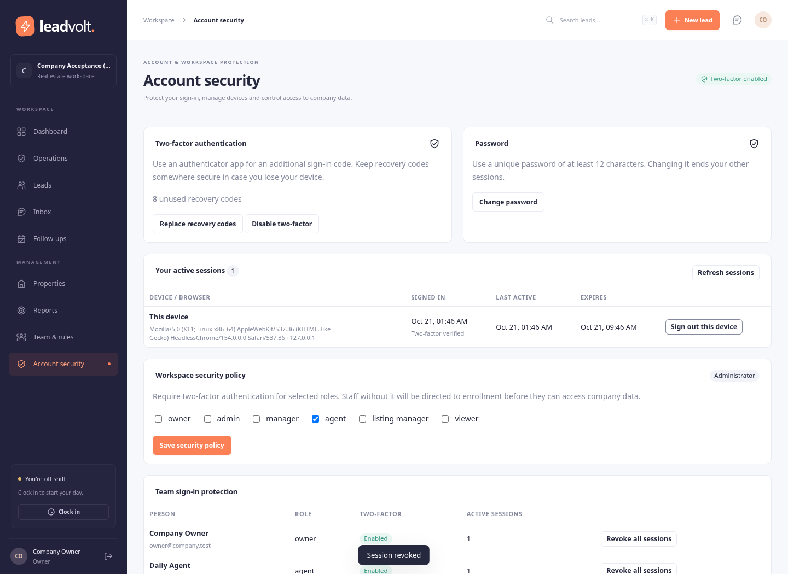
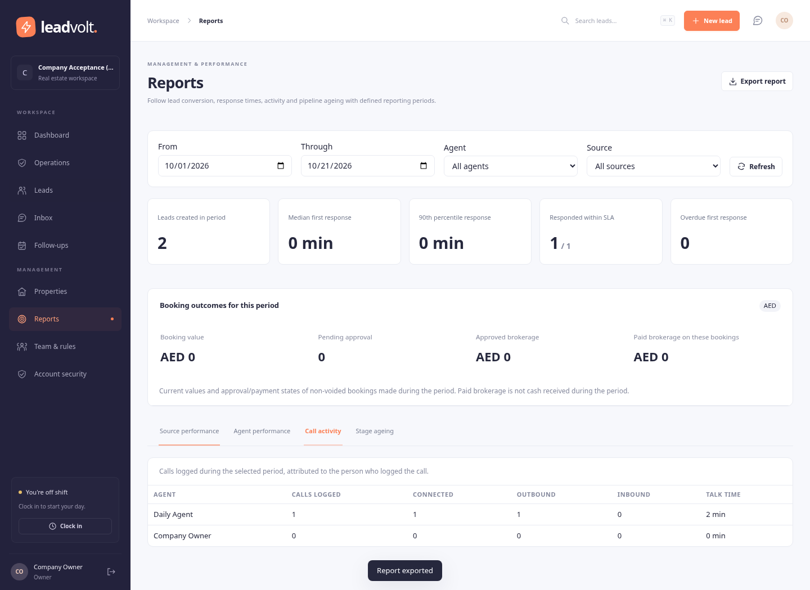
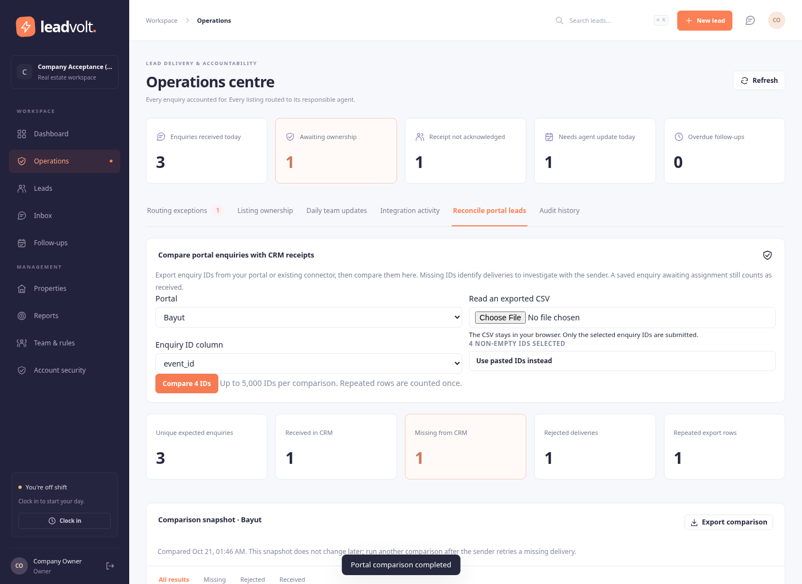

# Company controls release

The original goal was a premium CRM suitable for a large brokerage. The earlier delivery addressed routing but did not establish that overall product standard. This release adds working security, management and operational controls; it does not assign the product a subscription price.

Implemented interfaces: **Account security**, **Reports**, saved views in **Leads**, and **Operations → Reconcile portal leads**. Authenticator MFA supports QR enrollment, one-use recovery codes, revocable devices, password change and administrator role policies. Shared views do not expand an agent's data access. Reports separate lead cohorts, logged activity and current pipeline state. Reconciliation compares upstream IDs with accepted/rejected CRM receipts and records a snapshot.

The booking review API supports pending commission review, approval, external invoice references and payment references. Approved financial values are protected from later lead edits. The booking review UI remains pending. No legal invoice, bank payment or paid-transaction reversal is generated.

Validation artifacts are in company-validation. The existing browser regression covered 19 scenarios, the routing acceptance covered 7, and the company-controls browser script covered 10 new scenarios. New booking APIs are covered by real-database tests; their UI is not included in those browser claims. Published test totals are recorded in automated-results.json after the final run.

The local load fixture submitted 400 deliveries representing 200 enquiries and 200 retries. It saved 200 leads and delivered all 200 agent notifications, with zero wrong-owner/failed deliveries. HTTP p95 was 294 ms and live-notification p95 296 ms on this local environment; these numbers are not a production capacity promise. The latest dependency audit reported zero advisories.

The admin-confirmed Bayut connector, complete booking UI, SSO, broader integrations, independent security review and live acceptance remain outstanding. See [NEXT_SESSION.md](../NEXT_SESSION.md) for the exact continuation point, configuration changes, tests and product gaps. Finalization was requested because the user's credits were exhausted; do not mistake a saved checkpoint for a completed premium-product certification.
